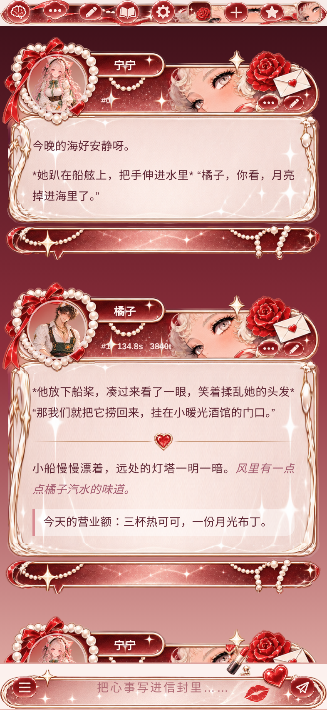

# 珍珠女士（酒馆美化）

宁宁 × Claude 自制的 SillyTavern 手机端美化：酒红、珍珠、玫瑰和复古少女漫。素材都是透明底 PNG，通过 jsDelivr 引用。

- 导入：酒馆 → 用户设置 → UI 主题 → 导入 `珍珠女士.json`
- 调位置、颜色：改 `src/theme.css` 开头 `:root` 里的变量，然后运行 `python3 src/build.py` 重新生成 JSON
- 链接前缀：`https://cdn.jsdelivr.net/gh/Ttsningning/orange-shop-assets1@main/pearl/`

| 文件 | 用在哪 |
|---|---|
| bubble_top / bubble_mid / bubble_bot | 消息气泡的头部（珍珠头像圈）、正文（九宫格拉伸）、尾部 |
| bubble_top_heart | 备用头部：爱心窗口款 |
| ring_overlay | 盖在头像上面的珍珠圈（中间挖空） |
| topbar / input_bar | 顶栏、输入框 |
| btn_* / ico_* | 输入框按钮、编辑、更多、星标、箭头、勾叉、顶栏图标 |
| frame_circle / frame_heart / frame_portrait | 备用头像框 |
| panel_bg.jpg | 所有设置面板的浅色背景插画 |
| deco_* / spinner / btn_loadmore / panel_scene / tile_* | 装饰（口红（deco_lipstick2）、爱心宝石、信封、樱桃、星光）、加载图标、加载更多按钮、场景小图 |

