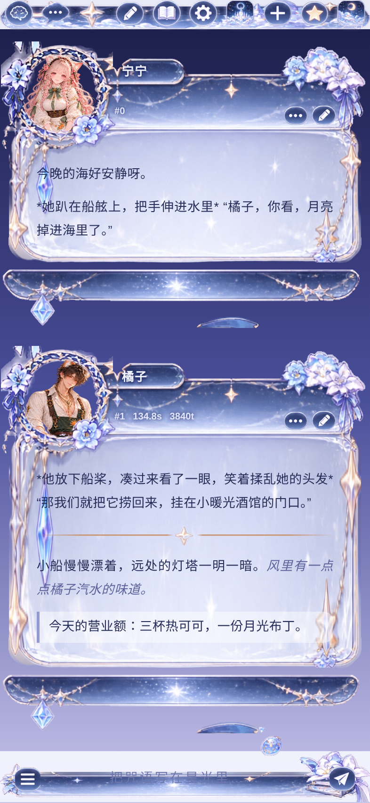

# 星月法师（酒馆美化）

宁宁 × Claude 自制的 SillyTavern 手机端美化：深蓝夜空、星月、水晶和白猫的魔法师主题。素材都是透明底 PNG，通过 jsDelivr 引用。

- 导入：酒馆 → 用户设置 → UI 主题 → 导入 `星月法师.json`
- 调位置、颜色：改 `src/theme.css` 开头 `:root` 里的变量，然后运行 `python3 src/build.py` 重新生成 JSON
- 链接前缀：`https://cdn.jsdelivr.net/gh/Ttsningning/orange-shop-assets1@main/starmage/`

| 文件 | 用在哪 |
|---|---|
| bubble_top / bubble_mid / bubble_bot | 消息气泡的头部、正文（九宫格拉伸）、尾部 |
| ring_overlay | 挖空的头像框，盖在头像上面 |
| bubble_top_cat | 备用头部 |
| topbar / input_bar | 顶栏、输入框 |
| btn_* / ico_* | 输入框按钮、编辑、更多、星标、箭头、勾叉、顶栏图标 |
| frame_circle / frame_cat / frame_moon | 备用头像框 |
| panel_bg.jpg | 所有设置面板的浅色背景插画 |
| deco_lantern（滑块）、deco_bottle（输入框旁）、deco_books、deco_small（小星星，标题和分割线） | 装饰 |
| spinner / btn_loadmore / panel_scene / tile_a / tile_b | 加载图标、加载更多按钮、场景图、顶栏小图 |

